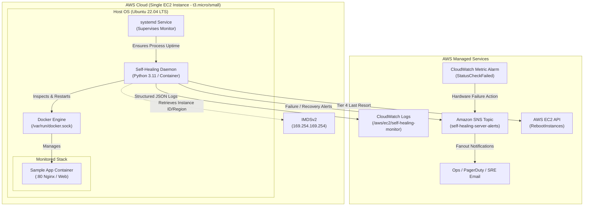

# AWS Self-Healing Server Monitor & Automated Recovery System

An automated, intermediate-level self-healing supervisor engineered for Linux workloads on AWS EC2. It actively inspects networking (HTTP, TCP, Ping, DNS), container lifecycles (Docker status, healthcheck states, restart loops), and host resources (CPU, Memory, Disk), executing **tiered automated recovery** with exponential backoff and rate-limiting safeguards before escalating.

---

## 1. System Architecture

### High-Level Topology (Mermaid)



### Tiered Recovery Escalation Ladder (ASCII)

```
        +-------------------------------------------------------+
        |                HEALTH CHECK CYCLE                     |
        |  HTTP (Latency/Code) | TCP | Ping | DNS | Docker | OS  |
        +-------------------------------------------------------+
                                    |
                            [Unhealthy Check]
                                    |
                    (Consecutive Failures >= 3 ?)
                      /                       \
                    No                         Yes
                   /                             \
        [Log Warning & Continue]        [Check Safeguards]
                                         - Cooldown (180s) ?
                                         - Max 5 recoveries / hr ?
                                                  |
                                                  v
     +--------------------------------------------------------------------------+
     | ESCALATION TIERS                                                         |
     |                                                                          |
     |  [Attempts 1-2] Tier 1: Soft Container Restart                           |
     |                         `docker restart <container>`                     |
     |                                                                          |
     |  [Attempt 3]    Tier 2: Stack Recreate                                   |
     |                         `docker compose up -d --force-recreate <service>`|
     |                                                                          |
     |  [Attempt 4]    Tier 3: Host Service / Daemon Restart                    |
     |                         `systemctl restart docker.service`               |
     |                                                                          |
     |  [Attempt 5]    Tier 4: Host EC2 Reboot (Last Resort)                    |
     |                         `boto3.client('ec2').reboot_instances(...)`      |
     +--------------------------------------------------------------------------+
                                    |
                        [Publish SNS Alert & JSON Log]
```

---

## 2. Project Structure

```
self_healing_monitor/
├── .env.example                       # Sample environment variables
├── Dockerfile                         # Python 3.11 container with Docker CLI & network tools
├── docker-compose.yml                 # Orchestrates monitor daemon + sample Nginx app
├── requirements.txt                   # Python dependencies (pyyaml, psutil, docker, boto3)
├── main.py                            # Entrypoint loop & signal handling
│
├── config/
│   ├── config.yaml                    # Health check thresholds, intervals, safeguards
│   └── loader.py                      # YAML parser, env overrides & AWS IMDSv2 client
│
├── checks/
│   ├── __init__.py
│   ├── http_check.py                  # HTTP probe: status codes & response time SLAs
│   ├── tcp_check.py                   # Raw TCP socket handshake probe
│   ├── ping_dns_check.py              # ICMP ping & DNS resolution probes
│   ├── docker_check.py                # Docker status, healthcheck & restart loop detector
│   └── system_metrics.py              # Host CPU, Memory, Disk usage thresholds (psutil)
│
├── recovery/
│   ├── __init__.py
│   ├── state_tracker.py               # Failure streaks, exponential backoff & rate limiting
│   ├── actions.py                     # Implementations for Tiers 1-4 with dry-run support
│   └── engine.py                      # Tier selection, escalation logic & notification hooks
│
├── alerts/
│   ├── __init__.py
│   └── sns_alerter.py                 # AWS SNS publisher with structured diagnostics
│
├── logging_utils/
│   ├── __init__.py
│   └── json_logger.py                 # Structured JSON formatter & CloudWatch shipper
│
├── api/
│   ├── __init__.py
│   └── status_api.py                  # Lightweight /health, /status, /history HTTP endpoints
│
├── systemd/
│   └── self-healing-monitor.service   # Systemd service unit for host-level supervision
│
├── aws/
│   ├── iam_policy.json                # Least-privilege IAM policy document
│   └── ec2_user_data.sh               # Cloud-init bootstrap script for Ubuntu 22.04 LTS
│
├── terraform/
│   ├── main.tf                        # EC2, IAM, SNS, Security Groups, CloudWatch Alarm
│   ├── variables.tf                   # Configurable parameters (region, instance type)
│   └── outputs.tf                     # Instance IP, SNS ARN, Log Group outputs
│
├── scripts/
│   └── simulate_failure.sh            # Chaos injection: kill container, block port, fill disk
│
├── nginx-html/
│   └── index.html                     # Sample web workload index page
│
└── tests/
    └── test_checks.py                 # Unit tests for state tracking and safeguards
```

---

## 3. Step-by-Step Deployment Guide

### Option A: Automated Provisioning with Terraform (Recommended)

1. **Prerequisites**:
   - AWS CLI configured (`aws configure`) with credentials having EC2/IAM/SNS rights.
   - Terraform installed (`>= 1.5.0`).

2. **Initialize and Plan**:
   ```bash
   cd terraform
   terraform init
   terraform plan -var="alert_email=your-email@example.com" -var="aws_region=us-east-1"
   ```

3. **Deploy Infrastructure**:
   ```bash
   terraform apply -auto-approve -var="alert_email=your-email@example.com"
   ```
   *Note: Check your inbox and click "Confirm Subscription" on the Amazon SNS confirmation email.*

4. **Outputs**:
   Terraform outputs the public IP, EC2 instance ID, and CloudWatch Log Group.

---

### Option B: Manual Host Deployment on Existing EC2 Instance

1. **SSH into the EC2 instance**:
   ```bash
   ssh -i your-key.pem ubuntu@<EC2_PUBLIC_IP>
   ```

2. **Clone the repository**:
   ```bash
   sudo mkdir -p /opt/self-healing-monitor
   sudo chown -R ubuntu:ubuntu /opt/self-healing-monitor
   cd /opt/self-healing-monitor
   # Copy or git pull project files into /opt/self-healing-monitor
   ```

3. **Deploy via Docker Compose**:
   ```bash
   docker compose up -d --build
   ```

4. **Verify Container Status & Logs**:
   ```bash
   docker compose ps
   docker compose logs -f self-healing-monitor
   ```

5. **Query the Status API**:
   ```bash
   curl -s http://localhost:8080/status | jq .
   ```

---

## 4. Chaos Engineering & Failure Simulation

Use the bundled `scripts/simulate_failure.sh` to trigger real failure states and confirm recovery:

| Test Case | Command | Triggered Escalation | Expected Outcome |
| :--- | :--- | :--- | :--- |
| **Kill Container** | `./scripts/simulate_failure.sh kill-container` | Tier 1 (Restart container) | Monitor detects missing container on next cycle, calls `docker restart sample-nginx`, publishes SNS recovery event. |
| **Drop Network Port** | `./scripts/simulate_failure.sh block-port` | Tier 1 -> Tier 2 -> Tier 3 | iptables drops TCP port 80. HTTP probe times out. Escalates through compose recreate and host service restart. |
| **Restore Network** | `./scripts/simulate_failure.sh unblock-port` | Nominal | iptables drop rule removed; checks recover to healthy status. |
| **Disk Space Alarm** | `./scripts/simulate_failure.sh fill-disk` | System Alert | Creates a 5GB file exceeding threshold. Monitor logs disk warning event and issues SNS alert. |
| **Disk Cleanup** | `./scripts/simulate_failure.sh clean-disk` | Nominal | Reclaims disk space; status returns to green. |

---

## 5. Security & Least Privilege

- **No Hardcoded Secrets**: Uses AWS IAM Instance Profiles and IMDSv2 session tokens.
- **Scoped EC2 Reboot**: IAM policy restricts `ec2:RebootInstances` to instances tagged `SelfHealingMonitored = "true"`.
- **Restricted Network Ingress**: Security group exposes only Port 80 (Web), Port 8080 (Status API), and restricts SSH.

---

## 6. Architecture Improvements & Next Steps

1. **AWS Auto Scaling Group (ASG) Health Checks**: Replace single EC2 instance with an ASG (`Min: 1, Max: 1, Desired: 1`) utilizing custom lifecycle hooks or ELB target group health checks for automatic replacement upon hypervisor termination.
2. **Container Orchestration (Amazon ECS / EKS)**: Transition standalone Docker Compose workloads to Amazon ECS with Fargate, leveraging native task auto-recovery, container healthchecks, and circuit breakers.
3. **Route 53 DNS Failover**: Configure Route 53 latency or failover routing policies pointing to an active-passive standby instance in a secondary Availability Zone.
4. **AWS Systems Manager (SSM) Agent**: Replace SSH port 22 access entirely with AWS Systems Manager Session Manager for passwordless, audited remote shell sessions.
